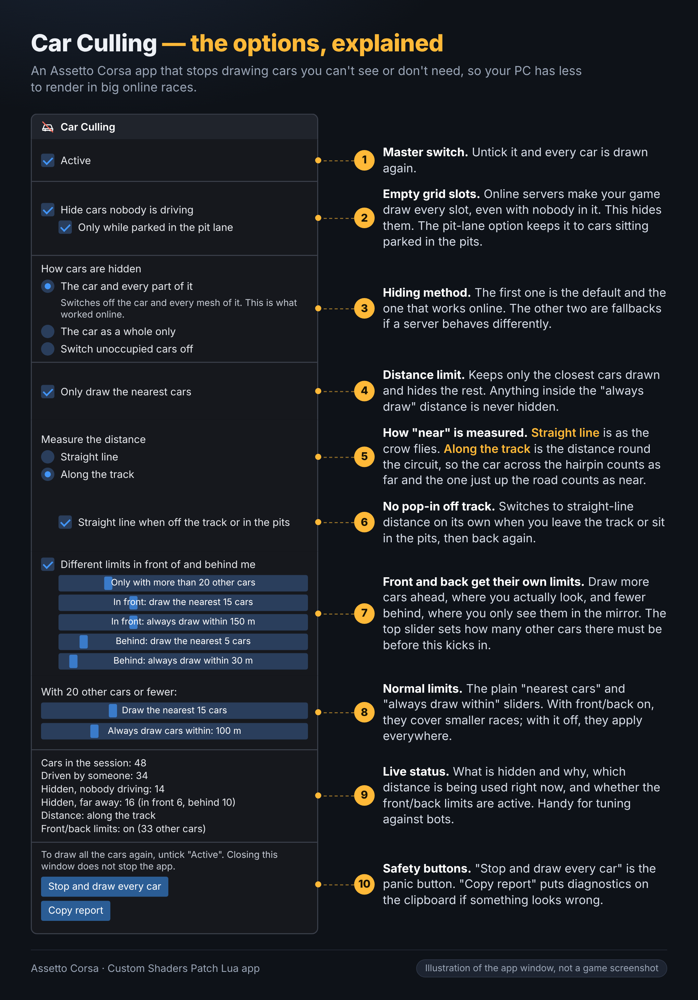

# Car Culling

An Assetto Corsa app (a [Custom Shaders Patch](https://acstuff.club/patch/) Lua app) that stops drawing the cars you can't see or don't need, so your PC has less to render in big online races.

<p align="center">
  
</p>

<sub>The picture is an illustration of the app window (same labels, same order), not an in-game screenshot.</sub>

## Why

Online servers make the game draw every car slot, including the ones nobody is driving. In a full-grid race the game also draws dozens of cars you will never look at. Car Culling hides both, and only the 3D models: physics, collisions and the network are not touched, so a hidden car can still be hit.

## Features

- **Hide cars nobody is driving.** Empty slots are not drawn (optionally only while they are parked in the pit lane). A car is drawn again as soon as a driver joins its slot or it starts moving.
- **Only draw the nearest cars.** Draw the nearest N cars plus every car inside an "always draw" distance, and hide the rest. Your own car and the car you are watching are always drawn.
- **Two ways to measure distance.**
  - *Straight line*: as the crow flies.
  - *Along the track*: the distance you would have to drive. A car on the far side of a hairpin counts as far away even if it is close in a straight line, because you are much less likely to see it. A car less than 20 m away is never hidden because of this.
- **No pop-in off the track.** With *Straight line when off the track or in the pits* on, the app switches to straight-line distance by itself while you are off the track (3 or more wheels, plus about 2 seconds after) or in the pit lane, and when the camera is far from the car (replays, free camera).
- **Separate limits in front of and behind you.** Draw more cars ahead, where you look, and fewer behind, where you only see them in the mirror. This only applies above a number of other cars you choose; below it, the normal limits are used. Cars have to move 5 m into the other half before they change sides, so cars side by side don't flicker in and out.
- **Works in races against bots too**, so you can tune the settings offline. Bots count as drivers, so *Hide cars nobody is driving* leaves them alone (it only hides the empty slots of an online server).
- **Live status** in the window: cars in the session, hidden as empty, hidden as far away (in front and behind), which distance measure is in use, and whether the front/back limits are active.

## Install

1. Copy the `CarCulling` folder into your Assetto Corsa install, so you end up with:

   ```
   assettocorsa\apps\lua\CarCulling\CarCulling.lua
   assettocorsa\apps\lua\CarCulling\manifest.ini
   assettocorsa\apps\lua\CarCulling\icon.png
   ```

   (When updating, delete the old `CarCulling` folder first and copy all three files, since the manifest changes between versions.)

2. Restart the game (not just the session) and join an online server or a race against bots.
3. The app starts by itself with the game and keeps running with its window closed. To change settings or see the counters, open **Car Culling** from the in-game app list.

**Requires** Assetto Corsa with a recent version of Custom Shaders Patch (the app uses CSP's Lua scene API).

## Options explained

The numbers match the picture above.

| # | Option | What it does |
|---|--------|--------------|
| 1 | **Active** | Master switch. Untick it and every car is drawn again. |
| 2 | **Hide cars nobody is driving** | Hides the empty slots. *Only while parked in the pit lane* limits it to cars sitting parked in the pits. |
| 3 | **How cars are hidden** | *The car and every part of it* (default, the one that works online), *The car as a whole only* (lightest, but online the game may switch the car on again before it is drawn, so it can flicker), *Switch unoccupied cars off* (uses `ac.setCarActive` for empty slots; far cars still use the first way). Try the third if the first leaves cars drawn or cars don't come back. |
| 4 | **Only draw the nearest cars** | Turns the distance limit on. Cars inside the "always draw" distance are never hidden. |
| 5 | **Measure the distance** | *Straight line* or *Along the track* (see above). |
| 6 | **Straight line when off the track or in the pits** | Automatic fallback to straight-line distance, only used with *Along the track*. |
| 7 | **Different limits in front of and behind me** | Separate "draw the nearest N cars" and "always draw within X m" for the front and the back, and *Only with more than N other cars* to set when this takes over. A car is "in front" when it is ahead of the nose of the car you are watching, seen from above. |
| 8 | **Normal limits** | The plain "draw the nearest N cars" and "always draw within X m" sliders. With front/back on they cover smaller races (shown under "With N other cars or fewer"); with it off they apply everywhere. |
| 9 | **Live status** | What is hidden and why, and which distance is in use right now. Handy for tuning against bots. |
| 10 | **Stop and draw every car** / **Copy report** | The panic button, and a diagnostics report copied to the clipboard. |

The window only shows the sliders that do something with your current settings.

## Getting the cars back

- Untick **Active**: every car is drawn again. Closing the window does **not** stop the app, only unticking *Active* does.
- **Stop and draw every car** unticks *Active* and tries again for any car that did not come back. The window turns red if a car could not be put back completely.
- To remove the app, delete the `CarCulling` folder.

## Tuning tips

- Start with the defaults, then open the window and watch the *Hidden, far away* counter while you adjust the sliders.
- If you clip your mirror render distance, put the tighter limits on the **back**: cars you only see in the mirror pop in less noticeably than cars in front.
- If cars pop in around you off the track, make sure *Straight line when off the track or in the pits* is on, or use *Straight line* for everything.

## How it works

Online, hiding the car's scene node alone only makes it flicker (the game appears to switch it back on), and hiding every mesh of the car works but needs a reliable way back. So the app looks up all the meshes of a car once, before it is first hidden, remembers which of them were visible, and holds on to those references. It hides the car again at several moments of each frame, and restores each mesh with its own state when the car should be drawn. The result is checked afterwards, with a second restore method if the first did not work.

## Reporting problems

Open an issue and paste the text from **Copy report**. It includes the version, hide method, distance mode, front/back state, hidden counts and whether every car came back, which is usually enough to see what went wrong. Please also say which settings you used and whether you were online or against bots.

## Credits

Built with [Claude](https://claude.ai) (Anthropic) and tested in Assetto Corsa online and against bots.
